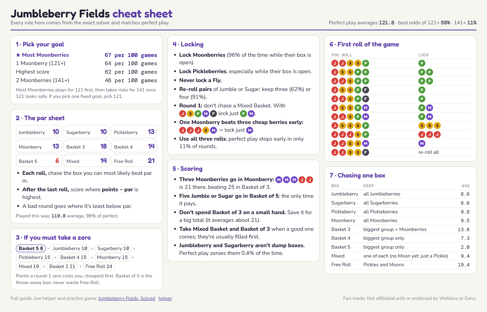

# Jumbleberry Fields, Solved

An exact solver for the Webkinz dice game *Jumbleberry Fields*, plus tools that help players use it: a strategy report, a live helper for real games, a practice game with a coach and trainer, and a one-page cheat sheet.

**Use it:** <https://carterkowel.github.io/webkinz/>. On a computer, scan the QR code with your phone, then prop the phone sideways facing your game: it shows which jars to lock and which box to click, and keeps score by itself.



## Headline results

* **Perfect play averages 121.8 points**, and the 1-Moonberry prize starts at 121. Even flawless play reaches 121 only 54–58% of the time, and 141 (two Moonberries) at best 11% of the time.
* **Most Moonberries over time:** the best strategy wins 66.8 Moonberries per 100 games. Always playing for 1 Moonberry wins 63.8; always chasing 2 wins only 46.3.
* **A 9-number par sheet** plus "chase one box at a time" averages 119.8, which is 98% of perfect.
* **Graded move by move against perfect play:**
  * A deep Q-network that taught itself reaches 121.0.
  * Tabular Q-learning stalls at 111.9.
  * Claude Opus 5.5, reasoning from the rules alone over 25 games, plays at about 116.8.
  * 21 logged human games average 114.9.

## For players

Everything in `site/dist/` runs in the browser with no server. It is published to GitHub Pages by [`.github/workflows/pages.yml`](.github/workflows/pages.yml) whenever it changes on `main`, and it works on any other static host too.

| Page | What it is |
|---|---|
| `index.html` | **Jumbleberry Fields, Solved**: the report, with charts, the par sheet, worked examples, and the helper and practice game embedded |
| `helper.html` | **Helper** for real games: tap in your berries, snap a photo of the game screen, or point your phone's live camera at it, and it tells you which jars to lock or which box to fill, with live odds of 121+ and 141+ |
| `play.html` | **Bramble Dice**: an original practice game with the same odds and scoring math, a coach, a trainer mode, an end-of-game review and an optional shared leaderboard |
| `method.html` | **How I solved it**, step by step, with a live "ask the solver" panel |
| `cheatsheet.html` / `.png` | **One-page cheat sheet**, printable or as an image |

See [`site/README.md`](site/README.md) for hosting, embedding the game or helper in your own page, and setting up the leaderboard.

## For developers

```bash
python -m venv .venv && . .venv/bin/activate        # Windows: .venv\Scripts\activate
pip install -r requirements.txt
cd jumbleberry_fields                                # Python scripts run from here
python solver.py                                     # exact solver: prints 121.8025 and the prize odds
python advisor.py --berries "M M P J F" --roll 1     # best move for a position
```

The `jumbleberry_fields/` folder:

| File | What it does |
|---|---|
| `engine.py` | Game core: hands as berry counts (126 hands, 252 possible locks), scoring, roll probabilities |
| `solver.py` | **Exact optimal play** by dynamic programming. `ExpectedScoreSolver` maximises the average in under 1 s. `ThresholdSolver` maximises P(score ≥ target). `PrizeSolver({121: 1, 141: 1})` maximises Moonberries per game |
| `strategies.py`, `baselines.py` | Strategy library (random, heuristics, par sheet, optimal) and a simulator that grades every decision |
| `advisor.py`, `review.py` | Best move for any position, and a move-by-move review of logged games |
| `agent_play.py` | Turn-by-turn command-line game for scripts and AI agents; logs every decision |
| `rl_env.py`, `rl_qlearning.py`, `rl_dqn.py` | Reinforcement learning: full-game environment (masked actions, `gymnasium` wrapper), tabular Q-learning, and Double DQN (PyTorch) |
| `analysis.ipynb` | The analytics notebook |
| `main.py`, `game.py`, `berries.py`, `player.py` | The original command-line version of the game (`python jumbleberry_fields/main.py`) |
| `data/`, `models/` | Logged games and trained DQN weights; large caches are regenerated locally |
| `archive/` | Early RL experiments, kept for history |

The browser pages live in `site/src/`; `site/src/jbf-engine.js` is a JavaScript port of the solver.
- **Rebuild the pages:** `python ../site/export_page_data.py ../site/page_data.json && python ../site/build.py` (from `jumbleberry_fields/`). Commit `site/dist/` and push to `main` to publish.
- **Run the tests:** `PYTHONPATH=. python tests/tests.py` (from `jumbleberry_fields/`), then `node site/test_engine.js` (from the repo root).

## Rules as modelled

Each of the 5 jars is a 10-sided die: 3 Jumbleberry (2 points), 3 Sugarberry (2), 2 Pickleberry (4), 1 Moonberry (7) and 1 Fly (0).
- **Rounds and rolls:** 9 rounds, each with up to 3 rolls. You can lock any jars between rolls.
- **Boxes:** each round fills one of 9 boxes, and a box can take a zero.
- **Baskets:** Basket of 3, 4 or 5 needs that many matching jars, and Flies count as a match. Mixed Basket needs one each of Jumbleberry, Sugarberry, Pickleberry and Moonberry. All the basket boxes and Free Roll score the total of all five jars.

Odds and prize thresholds come from the [Webkinz Guide wiki](https://webkinzguide.com/wiki/Jumbleberry_Fields).

## Credits

* Ballpark Figures' video [I Solved Yahtzee*](https://www.youtube.com/watch?v=DOgb5wrb7mM) ([blog](https://ballparkfigures.substack.com/p/yahtzee), [code](https://github.com/Ballpark-Figures/yahtzee)) solves Yahtzee with the same technique.
* Tom Verhoeff's work on optimal solitaire Yahtzee is the classic reference.

## License and trademarks

Code is released under the [MIT License](LICENSE).

This is an unofficial fan project. Webkinz and Jumbleberry Fields are trademarks of Ganz, which has not endorsed or reviewed this project. No Webkinz artwork is included. Bramble Dice is an original game with its own name and artwork.
